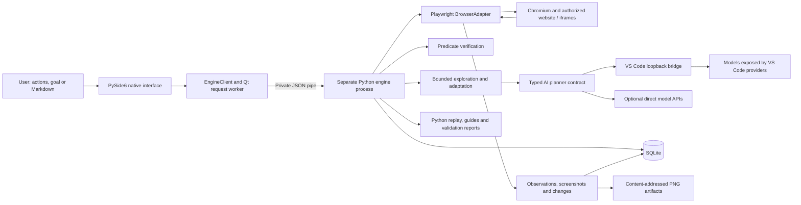
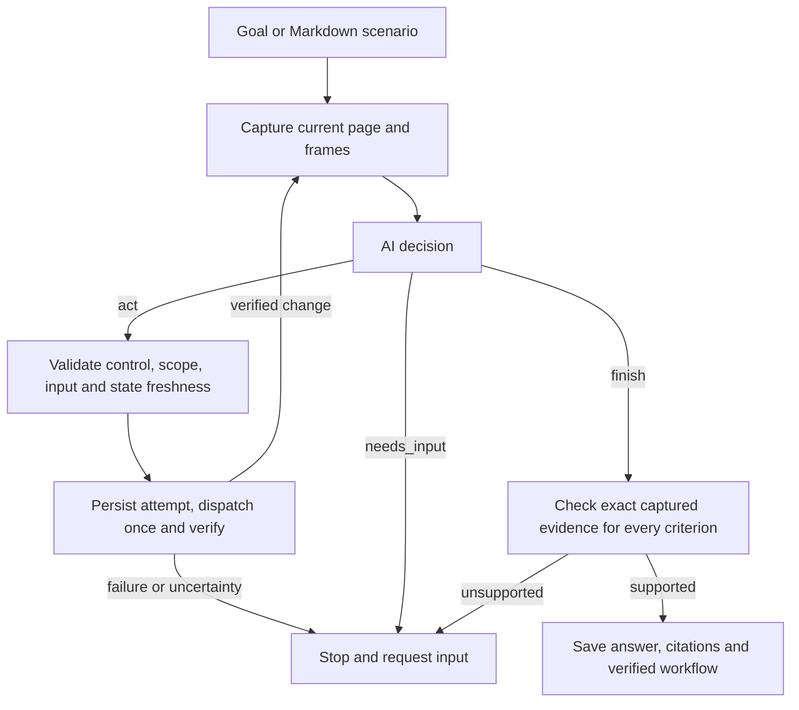

# Application Explorer: portable architecture and implementation specification

This is a standalone specification for rebuilding the application in a new project. It contains no source references, existing runtime records, machine-specific paths, credentials, recorded workflow IDs, or dependencies on a previous installation. Start with an empty database and generate all runtime data in the new deployment.

## 1. Purpose and implementation scope

Build a native Python application that observes a website, performs instructed actions through Playwright, records what changed, verifies expected outcomes, and saves reusable workflows in SQLite. Support manual operation and AI-directed exploration from a direct goal or Markdown scenario. The model proposes actions; a deterministic engine validates and executes them.

The core scope includes browser exploration, verified recording, deterministic replay, explicit AI adaptation to changed pages, version comparison and fresh validation. Image labeling, coordinate actions, passive human recording, whole-site discovery, desktop control and website reconstruction are separate extensions.

“Learning” means retaining observations, decisions and verified workflow versions. It does not require training or fine-tuning a model. Replay means executable automation, not video playback.

## 2. Capability scope

| Capability | Scope | Boundary |
|---|---|---|
| Native Python interface | Core | Runs the browser workflow system; does not inherently control other desktop apps |
| Scoped website connection/navigation | Core | Explicit target and allowed origins |
| Screenshots and control highlighting | Core | Viewport capture; report capture limitations |
| Visible text, controls, links, values and options | Core | Hidden and virtualized states require interaction |
| Click, fill, select, hover and scroll | Core | Semantic targets; main-document scrolling |
| Sibling, nested and cross-origin iframes | Core | Authorized origins only; explicit frame paths and capture status |
| Manual command recording | Core | Records application-dispatched actions |
| AI-directed recording | Core | Bounded observe/plan/act/verify loop |
| Goals and Markdown scenarios | Core | Typed scenario and scoped instructions |
| Saved workflows and restart recovery | Core | Durable SQLite storage and a workflow library |
| Deterministic replay | Core | Stops on ambiguity, missing controls or failed checks |
| AI adaptation | Core | Explicit fresh recording; preserve the original |
| Version and instruction comparison | Core | Parent/derived relations and step differences |
| Fresh validation and guide export | Core | Predicates and completion evidence; not proof of every business rule |
| Screenshot AI input | Optional provider capability | Requires a compatible model and explicit image capability |
| Passive human interaction recording | Extension | Capture external user actions without dispatching them again |
| Image labeling and visual-coordinate actions | Extension | Region matching, confidence, coordinate reconciliation and verification |
| Whole-site discovery | Extension | Frontier management, state deduplication and measured coverage |
| Website reconstruction | Extension | Generate website code and compare against observed behavior |
| Desktop automation | Extension | Separate window/screenshot/input adapter |
| Public integration service | Extension | Authentication and external capability boundaries |
| Workflow variables and reusable sessions | Extension | Typed inputs, secret handling and session provisioning |

Core and extension classifications define the build scope; they are not claims that any particular installation has passed acceptance.

## 3. System architecture



The Qt worker keeps browser and model requests off the UI thread. The engine owns the browser and database writer. AI receives bounded context and returns a typed decision; it does not receive direct browser handles, database access, unrestricted scripts, or authority to expand the target scope.

## 4. Technology and module structure

Use Python 3.12+ with Playwright, PySide6, Pydantic, SQLAlchemy, Alembic and Pillow. Use pytest for Python tests and a JavaScript/TypeScript extension with Node tests for the VS Code bridge. Pin compatible versions when packaging and install the Chromium build required by Playwright.

Suggested project organization:

```text
application_explorer/
  pyproject.toml
  src/application_explorer/
    __main__.py
    cli.py
    ui.py
    process.py
    domain.py
    browser.py
    engine.py
    instructions.py
    planner.py
    exploration.py
    workflows.py
    verification.py
    storage.py
    export.py
    fixture.py
    assets/
    migrations/
  editor_bridge/
    extension entry point
    manifest and configuration
    tests/
  tests/
```

This tree is a proposed logical structure, not a reference to existing files. Each new installation chooses its own runtime location independently of the source tree.

| Module | Responsibility |
|---|---|
| Domain | Strict contracts for targets, observations, frames, elements, actions, predicates, decisions, differences and errors |
| Browser | Origin enforcement, browser lifecycle, frame inventory, capture, masking, semantic resolution and dispatch |
| Engine | Persist/dispatch/verify lifecycle, deduplication, workflow operations and baselines |
| Exploration | AI cycles, budgets, freshness, loop detection, cancellation and completion checks |
| Workflows | Adaptation, version relationships, changed steps/instructions and fresh validation |
| Planner | Provider adapters and strict model-output parsing |
| Instructions | Markdown parsing, normalization and scope validation |
| Verification | Predicates and before/after comparisons |
| Storage | Transactions, migrations, artifact hashes and backup/restore |
| Process | Bounded private JSON commands and process lifecycle |
| UI | User commands, screenshots, timeline, evidence and workflow review |
| Export | Python automation, guidelines, validation reports and manifest hashes |
| CLI | Interface launch, headless exploration, export, schemas and synthetic demonstrations |

### Contract details

Use strict types, reject unknown fields/nonfinite numbers, and include a schema version. Generate unique IDs and UTC timestamps. Keep observation-local element references separate from durable semantic target descriptors.

| Contract | Fields |
|---|---|
| Target | ID, name, start URL, allowed origins, optional HTTPS-upgrade policy |
| Element | Frame path, local reference, role, accessible name, optional test ID/link, bounds, enabled state, value, options, sensitivity |
| Frame | Path, URL, captured/blocked/hidden/unavailable status, optional reason/text, completeness, limitations |
| Observation | ID, target ID, timestamp, URL, title, visible text, elements, frames, screenshot reference, completeness, limitations |
| Action | ID, target ID, operation, descriptor, intent, optional value/scroll amount, postcondition, effect class, timeout |
| Predicate | Kind, optional target, expected string/list/null and result-frame scope |
| Decision | Act/finish/needs-input, explanation, nullable action/answer and citations |
| Citation | Criterion index, exact quote, frame path |
| Verification | Pass/fail/unknown, reason, observation ID |
| Difference | Before/after IDs, text/control/value/URL changes and per-frame changes |
| Error | Code, message and dispatch-uncertainty flag |

Click/hover require a target and no value. Fill/select require a target and value. Scroll requires a bounded nonzero amount and no element target/value. Resolve exactly one visible enabled control and reject sensitive targets. A stable test ID or role plus accessible name identifies an element; frame paths disambiguate matching controls across frames.

## 5. Observation, action and verification model

An observation records its ID, target, timestamp, URL, title, visible text, elements, screenshot artifact, completeness and limitations. Each element includes its role, accessible name, optional test ID, frame path, local reference, bounds, enabled state, value, options and sensitivity flag. Frame records identify the URL, path, visible text and whether capture was complete, partial, blocked, hidden or unavailable as applicable to the contract.

An action specifies `click`, `fill`, `select`, `hover` or `scroll`, an intent, target, optional value/scroll amount, timeout and expected postcondition. Semantic descriptors use a stable test ID or role/name plus optional frame path. An ambiguous match is an error, not an invitation to click the first result.

Supported predicate kinds in the contract:

| Predicate | What it establishes |
|---|---|
| `visible_text` | Expected text occurs in the captured scope |
| `url_equals` | The observed URL equals an expected URL |
| `element_visible` | One matching captured element is present |
| `element_hidden` | The matching element is absent from the captured scope; unavailable frames cannot establish absence |
| `selected_value` | A captured control has the expected value |
| `options_present` | A control contains the required options |
| `new_control_visible` | A new enabled, nonsensitive control of a requested role appears relative to the before observation |

Require two consecutive passing observations to establish a stable outcome. Differences identify added/removed text and controls, changed values, URLs and per-frame changes. A control in one iframe can have an expected result in another iframe.

**Important limit:** a manual action checked against text already present can satisfy a weak predicate without proving the action caused that text. The AI loop rejects already-satisfied postconditions and also requires a semantic transition. Predicates remain evidence checks, not causal proof or full business-rule validation.

### Durable execution algorithm

1. Validate request, target ownership and current browser connection.
2. Check the request ID and payload hash; return its previous outcome for an identical request and reject conflicting reuse.
3. Capture a before observation and resolve the exact target.
4. Atomically persist the command, run and prepared action before dispatch.
5. Persist the dispatch boundary, then call Playwright once.
6. Capture results until stable verification or timeout; compute differences and store events/results.
7. Return status, verification, explanations and before/after evidence references.

An exception before dispatch must be distinguishable from an uncertain outcome after dispatch. Preserve this distinction in replay and recovery. Request deduplication does not make external side effects exactly once.

## 6. Main workflows

### Manual recording

Connect a scoped website, inspect its controls, choose an operation and expected result, then execute and verify. Successful actions retain before/after evidence and run IDs. **Save verified sequence** converts selected successful runs into an ordered workflow. Failed or unverified runs cannot become saved workflow steps.

### AI-directed recording

Provide a goal or scenario, choose a provider/model, and start **Explore with AI**. Each cycle captures the current page, sends context to the planner, validates the returned decision, checks freshness again, executes one permitted action, verifies the result, and records the decision/outcome. Loop detection, an action budget and cancellation between cycles bound execution.



Choose a bounded action budget, for example a default of 12 and an allowed range of 1 to 100. A provider failure or uncertain dispatch does not trigger an automatic action retry. Completion requires exact quotes from the recorded frames for the declared criteria; quote provenance does not independently prove the answer's reasoning.

### Saved replay and restart recovery

Use **Refresh saved workflows**, select a sequence, then **Load selected workflow**. Loading connects its original target and scope without executing the actions. **Replay saved sequence** performs the saved actions in order, assigns fresh execution IDs, checks every postcondition and stops at the first failed or uncertain step. The starting URL, page state and required controls must be available.

### Adaptation to changed pages or instructions

**Adapt saved workflow with AI** explicitly starts a new recording from the original starting URL. It uses the original AI scenario unless the user supplies revised direct/Markdown instructions. Require a supplied scenario for a manually saved workflow when no original AI scenario exists.

The model receives original steps, current observations, starting-state differences and instruction changes. It selects current controls and verifies new actions. A successful result creates a new workflow and a parent/derived version relationship; it does not overwrite the original. Comparisons report replaced, inserted or removed step ranges and instruction changes. Failed adaptation leaves the original available.

This is fresh re-recording, not automatic continuation after an uncertain side effect. A fresh browser does not reset server-side application data or preserve a login.

### Fresh validation and export

**Validate saved workflow** starts a fresh browser, replays steps, marks unexecuted steps when execution stops, and checks recorded final completion quotes in their original frames. Thus navigation can succeed while changed answer text causes validation to request input. Reports are persisted separately from the original evidence.

**Export automation + guide** creates a new directory containing:

- `replay.py`: reusable Python automation using this package and Playwright.
- `workflow.json`: ordered action definitions.
- `guidelines.md`: instructions derived from recorded verified actions.
- `verification.json`: predicates and source verification references.
- `evidence/`: result screenshots.
- `fresh-validation.json`: latest fresh validation, when available.
- `version-comparison.json`: adaptation comparison, when available.
- `manifest.json`: export metadata and file hashes, plus a generated README.

Exports do not overwrite an existing directory. Generated guidelines describe observed behavior and recorded checks, not undiscovered server rules or independently established business requirements.

## 7. SQLite design and evidence storage

The new deployment creates a SQLite database plus a managed artifact tree of content-addressed PNG files. SQLAlchemy accesses SQLite; Alembic manages additive migrations. Storage enables foreign keys, WAL journaling, a busy timeout and full synchronous writes. Artifact paths are checked against the runtime root and verified against stored SHA-256 hashes.

| Table | Minimum fields and relationships |
|---|---|
| `targets` | ID primary key; target definition JSON |
| `artifacts` | ID; unique SHA-256; managed relative path; creation time |
| `observations` | ID; target foreign key; artifact foreign key; capture time; observation JSON |
| `runs` | ID; target foreign key; status; result JSON; creation time |
| `actions` | ID; run foreign key; before-observation foreign key; action JSON; status |
| `commands` | Request ID primary key; payload hash; run foreign key |
| `events` | Increasing sequence; run foreign key; event kind; payload JSON; timestamp |
| `workflows` | ID; target foreign key; name; ordered action-definition JSON; creation time |
| `baselines` | ID; observation foreign key; name; creation time |
| `explorations` | ID; target foreign key; status; scenario JSON; persisted state JSON; creation time |
| `exploration_events` | Increasing sequence; exploration foreign key; kind; payload JSON; timestamp |
| `workflow_versions` | ID; original/derived workflow foreign keys; exploration foreign key; comparison JSON; creation time |
| `workflow_validations` | ID; workflow foreign key; validation JSON; creation time |

Enforce uniqueness for each derived workflow's version relationship and associated exploration. Index observations by target/time and events by their run/session. Enforce allowed statuses and foreign keys. Use strict application contracts to validate JSON definitions before insertion.

Apply additive migrations in dependency order: core browser tables, exploration tables, then version and validation tables. Protect source artifacts, observations, saved workflows and baselines from accidental update/deletion with immutability rules. Append version and validation records rather than rewriting source evidence. Define a separate managed retention/deletion procedure.

Execution records progress through prepared/dispatch/verification states. Run outcomes include `running`, `succeeded`, `needs_input`, `failed` and `interrupted`. On restart, in-progress runs/explorations are marked interrupted and uncertain dispatch attempts are retained as unknown; they are not automatically resumed. Backup/restore helpers support a consistent SQLite copy with screenshot artifacts.

## 8. Provider-neutral AI integration

Define an asynchronous planner operation that accepts scenario/current observation/history/budget plus an optional masked screenshot, and returns the shared typed Decision contract. Record the actual provider, model and input mode. Keep provider-specific authentication, request encoding, timeouts and parsing inside adapters.

| Adapter | Implementation requirements |
|---|---|
| VS Code bridge | Discover models exposed through the supported editor language-model API; obtain consent through an explicit user action where required |
| Direct OpenAI API | Structured-output request, optional image input and strict decision parsing |
| Direct Gemini or other API | Provider-compatible structured response and optional image encoding; validate against the same decision contract |
| Local model | A genuine local provider or runtime implementing the planner contract; verify separately |

Do not embed assumed model names. Discover availability where possible or accept deployment configuration. A model listed by a provider may still reject requests because of account restrictions. An installed chat extension is not automatically a callable model provider. A provider alias is only a configuration label unless a separate adapter exists.

The VS Code extension should expose authenticated loopback model-listing, capability and chat endpoints. Generate credentials at runtime, bind only to loopback, reject unintended browser-origin requests and bound message/output sizes. Pass connection details through user-selected configuration or secure discovery; require no fixed port or developer profile path.

Advertise image support explicitly. Send masked PNG input only when the selected model/bridge supports it. Stop clearly on incompatible input rather than silently changing the requested mode. Test text and image modes independently.

A loopback connection describes transport location, not inference location. Hosting, quotas and billing depend on the actual model provider. Obtain API credentials through environment configuration or secure storage; never include real credentials or connection descriptors in distributed documentation, scenarios, logs or exports.

## 9. Scope, access and operational limits

- The application is a local tool. No application-level multi-user accounts, RBAC or approval engine are implemented.
- Browser targets have registered origins. Additional iframe or navigation origins must be explicitly authorized. HTTP-to-HTTPS upgrades are handled under the target's upgrade policy.
- Frame paths preserve action and text provenance. Unavailable/blocked frames are reported rather than counted as inspected.
- Password and marked sensitive regions are masked/redacted, and secret entry is unsupported. This is not comprehensive automatic personal-data detection.
- Page/model content is treated as evidence rather than authority to change policy. The AI cannot inject arbitrary browser scripts or widen target scope through its action contract.
- Command deduplication protects repeated request IDs; it is not a guarantee that every external side effect is exactly once. Unknown dispatch outcomes require inspection.
- Main-process messages are bounded to 1 MiB and use a private multiprocessing connection, not a public network endpoint. Provider connections have separate time/output limits.
- Captures can be partial. Dynamic menus, virtualized lists, offscreen content, unsupported roles and changing iframe structure can require additional actions or cause a stop.
- Authentication/session provisioning, reusable workflow variables, unattended server-state reset and general arbitrary-human-input recording remain outside the implemented workflow system.

## 10. Configuration and startup

A new deployment selects its own managed runtime directory and creates an empty database and artifact store on first startup. Do not distribute existing targets, screenshots, recordings, authentication state, workflow IDs or user data. Configuration must not rely on a previous installation.

Provide a Python package entry point that launches the native interface by default. Useful explicit command modes include:

- Run a synthetic headless demonstration.
- Execute a Markdown scenario with a selected provider/model and an action budget.
- Parse a scenario without executing it.
- Export a saved workflow to a new destination.
- Generate contract JSON Schemas.
- Render a UI smoke preview.

Make runtime location, browser installation, provider/model, connection details, timeouts and budgets configurable. Install dependencies and the matching Playwright browser as part of deployment. Keep synthetic fixtures separate from real target configuration.

Markdown requires a title and Goal, Start URL, Allowed origins and Success criteria sections; Guidance is optional. Accept UTF-8 with optional BOM, bound input size, reject duplicate sections and ensure the start URL belongs to declared scope.

Synthetic scenario example:

```markdown
# Inspect a catalog item

## Goal
Find the requested item and report its availability.

## Start URL
https://example.com/catalog

## Allowed origins
- https://example.com

## Success criteria
- Identify the requested item.
- Quote the displayed availability.

## Guidance
Use the visible search and filter controls, then inspect the detail view.
```

### Internal command protocol

Requests carry a protocol version, request ID, method and typed payload. Responses carry the request ID, success flag, and a result or structured error. Bound message size and waiting time.

Commands should cover connect/inspect/execute, model discovery, exploration start/step/stop, adaptation start, workflow save/list/load/replay/version comparison/validation/export, baseline save/compare and shutdown. These commands use a private engine transport; exposing them externally requires a separate authenticated service design.

## 11. Acceptance criteria for a new implementation

Use synthetic fixtures and newly generated data. Do not depend on another installation's databases, screenshots, recordings, IDs, credentials, ports, paths or test history.

| Area | Required verification |
|---|---|
| Clean startup | Initialize an empty runtime, apply migrations and open the interface |
| Contracts | Reject invalid types, extra fields, unsupported actions and ambiguous targets |
| Capture | Observe text, controls, options and masked screenshots; report limitations |
| Frames | Handle sibling/nested frames and authorized cross-origin content; verify cross-frame results |
| Actions | Exercise click/fill/select/hover/scroll and stable postconditions |
| Popups | Reveal/dismiss menus or banners and verify the transition without assuming hidden names |
| Recording | Save only verified successful runs with before/after evidence |
| Replay | Execute from a fresh start and stop on missing controls or failed checks |
| Restart | Retrieve saved workflows; mark interrupted execution without redispatch |
| Deduplication | Identical repeated request IDs do not repeat an action; conflicting payloads are rejected |
| AI | Reject invented controls/options, stale observations, loops, scope expansion and unsupported completion claims |
| Providers | Verify transport contracts and separate live text/image acceptance for every supported adapter |
| Adaptation | Rename controls/revise instructions, save a new version and preserve the original |
| Validation | Detect changed final evidence even when navigation succeeds; mark skipped steps |
| Export | Execute generated automation in a clean installation and verify manifest hashes |
| Recovery | Restore a consistent database/artifact set; reject corrupt or escaping artifact paths |
| UI | Long requests remain off the UI thread; cancellation is honored between cycles |

### Recommended build sequence

1. Define contracts, errors, SQLite tables and migrations.
2. Implement scoped browser/frame observation, masking and semantic resolution.
3. Implement transactional action execution, stable verification and differences.
4. Add the native interface and private engine process.
5. Add workflow persistence, restart recovery, replay and export.
6. Add Markdown scenarios and provider-neutral planning.
7. Add bounded exploration, freshness, loop detection and completion evidence checks.
8. Implement the VS Code bridge and any direct providers with independent acceptance.
9. Add explicit adaptation, version comparisons and revised instructions.
10. Add fresh validation and completion-evidence reports.
11. Verify clean installation, backup/restore and export portability.
12. Implement visual, passive-recording, desktop, coverage and reconstruction extensions separately.
